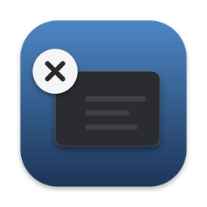
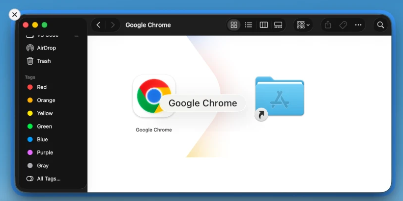

**English** | [简体中文](README.zh-CN.md)

# Close in Mission Control

A tiny Mac app that adds one thing to Mission Control: a **close button on the window you
point at**.

Coming from Windows, where Task View has an × on every window, Mission Control makes you
leave it just to close a window. This adds that ×, and nothing else.

- Close only. No minimize, no shortcuts, no settings to learn.
- Free and open source. No network access, no tracking, no auto-update.
- Mission Control itself is untouched; every other click works as it always has.
- Available in English and Simplified Chinese; it follows your Mac's language.

Works on Apple silicon and Intel Macs with macOS 14 or later. Tested on macOS 26.

## Install

**With Homebrew**

    brew trust --tap leyiwu/tap   # Homebrew asks you to trust third-party taps once
    brew install --cask leyiwu/tap/close-in-mission-control

**Or download it**

1. Download the `.dmg` from the
   [latest release](https://github.com/leyiwu/close-in-mission-control/releases/latest).
2. Open it and drag **Close in Mission Control** onto the Applications folder next to it.

**First launch**

macOS will not open the app the first time. You will see **"Close in Mission Control" Not
Opened**, because the app is not notarized by Apple (that costs a yearly fee for developers).
It is safe to continue:

1. Click **Done**, not Move to Trash.
2. Open System Settings → Privacy & Security, scroll down, and click **Open Anyway**.

(Or, in Terminal: `xattr -dr com.apple.quarantine "/Applications/Close in Mission Control.app"`)

A welcome window then asks for one permission, **Accessibility**. The app needs it to see
the window thumbnails in Mission Control and to press a window's own close button. The
window shows **Allowed** as soon as you switch it on.

## Using it

Open Mission Control, point at a window, and click the × on its top-left corner. A window
with unsaved changes shows its usual save prompt, so nothing is lost.

Click the × icon in the menu bar to turn on **Launch at Login** or to **Quit**. The menu
also shows which version you have, with a link to its release notes.

## Uninstall

1. Click the × icon in the menu bar. If **Launch at Login** is ticked, untick it. Then
   choose **Quit**.
2. Delete the app. Either drag **Close in Mission Control** from Applications to the Trash,
   or, if you installed it with Homebrew:

       brew uninstall --cask --zap close-in-mission-control

3. Remove its permission: System Settings → Privacy & Security → Accessibility, select it,
   and click **−**. Or in Terminal:

       tccutil reset Accessibility org.closeinmissioncontrol.app

4. If you did not use `--zap`, delete the log folder: `~/Library/Logs/CloseInMissionControl`.

That is everything. The app keeps no settings, accounts or other files.

## Good to know

- **No × on a window?** The app only shows one when it is sure which window you mean. Two
  windows with the same name and shape from *different* apps get none, and neither does a
  window that cannot be closed right now, such as one showing a sign-in prompt.
- **A closed window leaves an empty gap** until you leave Mission Control; macOS does not
  redraw it. QuickTime Player goes further and keeps playing until you leave.
- Only windows on the desktop you are viewing can be closed.
- Not supported: App Exposé (⌃↓). Not yet tested: external monitors and Stage Manager.
- **Privacy:** the app reads window titles and positions only to match thumbnails. It
  writes a small log of what it did to `~/Library/Logs/CloseInMissionControl/app.log`,
  which includes window titles and never leaves your Mac.
- macOS updates can break this kind of app. If the × stops appearing after an update,
  [open an issue](https://github.com/leyiwu/close-in-mission-control/issues).

## Similar projects

This one does a single thing. If you want more, these are good choices:

- [MissionClose](https://github.com/beqaabu/MissionClose) — free and open source. Adds
  close, minimize and full-screen buttons, keyboard shortcuts, quitting apps, App Exposé
  support and settings.
- [Mission Control Plus](https://fadel.io/missioncontrolplus) — a paid app with a free
  trial. Adds a close button plus ⌘W, ⌘M and ⌘Q shortcuts.

Want shortcuts, minimize or quit? Use one of those. Want only a close button that never
guesses which window you meant? This one.

## For developers

Build instructions, how it works and the release process are in
[DEVELOPING.md](DEVELOPING.md). The undocumented macOS behaviour it depends on is in
[DEPENDENCIES.md](DEPENDENCIES.md).

## License

MIT. See [LICENSE](LICENSE).
