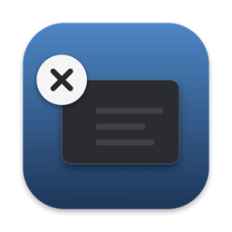
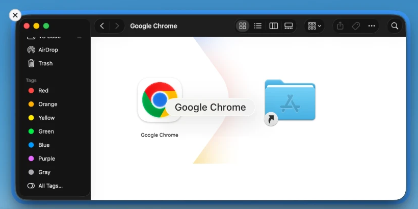

[English](README.md) | **简体中文**

# Close in Mission Control

一个很小的 Mac 应用，只给 Mission Control 加一样东西：**鼠标指着的那个窗口上的关闭按钮**。

从 Windows 转到 Mac 的人会发现：Windows 的任务视图里每个窗口都有 ×，而 Mission Control 要关窗口，得先退出它。这个应用补上那个 ×，仅此而已。

- 只做关闭。没有最小化，没有快捷键，也没有一堆设置要学。
- 免费开源。不联网，不追踪，不自动更新。
- Mission Control 本身不受影响，其他点击和平常完全一样。
- 界面有英文和简体中文两种，默认跟随你 Mac 的语言，也可以在菜单栏 × 图标 → **语言** 里自己选。

支持 Apple 芯片和 Intel 的 Mac，需要 macOS 14 或更高版本，在 macOS 26 上测试过。

## 安装

**用 Homebrew**

    brew trust --tap leyiwu/tap   # Homebrew 会要求你信任第三方仓库，只需一次
    brew install --cask leyiwu/tap/close-in-mission-control

**或者下载**

1. 从[最新发布页](https://github.com/leyiwu/close-in-mission-control/releases/latest)下载 `.dmg`。
2. 打开它，把 **Close in Mission Control** 拖到旁边的“应用程序”文件夹里。

**第一次打开**

macOS 第一次不会让你打开这个应用。你会看到一个提示，标题是 **“Close in Mission Control”未打开**（英文系统里是 “Not Opened”），原因是这个应用没有经过 Apple 公证（公证需要开发者每年付费）。可以放心继续：

1. 点 **完成**（Done），不要点“移到废纸篓”。
2. 打开 系统设置 → 隐私与安全性，滚动到下面，点 **仍要打开**（Open Anyway）。

（也可以在终端里运行：`xattr -dr com.apple.quarantine "/Applications/Close in Mission Control.app"`）

之后会出现一个欢迎窗口，请你允许一项权限：**辅助功能**。应用需要它来看到 Mission Control 里的窗口缩略图，并点按窗口自带的关闭按钮。你打开开关后，窗口会立刻显示 **已允许**。

## 使用

打开 Mission Control，把鼠标移到一个窗口上，点它左上角的 ×。如果窗口里有没保存的内容，会照常弹出保存提示，所以不会丢东西。

点菜单栏里的 × 图标，可以开启 **登录时启动**、切换 **语言**，或者 **退出**。菜单里还会显示你用的是哪一版，并有一个指向更新说明的链接。

## 卸载

1. 点菜单栏里的 × 图标。如果 **登录时启动** 是勾选的，先取消勾选，然后选 **退出**。
2. 删除应用。可以把 **Close in Mission Control** 从“应用程序”拖进废纸篓；如果是用 Homebrew 安装的：

       brew uninstall --cask --zap close-in-mission-control

3. 去掉它的权限：系统设置 → 隐私与安全性 → 辅助功能，选中它，点 **−**。或者在终端里运行：

       tccutil reset Accessibility org.closeinmissioncontrol.app

4. 如果没有用 `--zap`，再删除日志文件夹 `~/Library/Logs/CloseInMissionControl` 和偏好设置文件
   `~/Library/Preferences/org.closeinmissioncontrol.app.plist`。

就这些了。应用唯一会记住的是你选的语言（如果你选过），不保存账号或其他文件。

## 需要知道的

- **某个窗口上没有 ×？** 只有在确定你指的是哪个窗口时，应用才会显示它。*不同*应用里名字和形状都一样的两个窗口不会显示，当前无法关闭的窗口也不会，比如正在显示登录提示的窗口。
- **关掉窗口后会留下一个空位**，直到你离开 Mission Control，macOS 不会重新排列。QuickTime Player 更特殊：它会一直播放，直到你离开。
- 只能关闭你当前所在桌面上的窗口。
- 不支持 App Exposé（⌃↓）。外接显示器和台前调度还没有测试过。
- **隐私：** 应用只读取窗口标题和位置，用来匹配缩略图。它会在 `~/Library/Logs/CloseInMissionControl/app.log` 里写一份简短的运行记录，里面有窗口标题，并且不会离开你的 Mac。
- macOS 更新可能会让这类应用失效。如果更新后 × 不再出现，请[提一个 issue](https://github.com/leyiwu/close-in-mission-control/issues)。

## 类似的项目

这个应用只做一件事。如果你想要更多功能，下面这些也不错：

- [MissionClose](https://github.com/beqaabu/MissionClose)：免费开源。有关闭、最小化、全屏按钮，键盘快捷键，退出应用，App Exposé 支持和设置。
- [Mission Control Plus](https://fadel.io/missioncontrolplus)：付费应用，有免费试用。除了关闭按钮，还有 ⌘W、⌘M 和 ⌘Q 快捷键。

想要快捷键、最小化或退出应用？用它们。只想要一个绝不会猜错窗口的关闭按钮？用这个。

## 给开发者

构建方法、工作原理和发布流程在 [DEVELOPING.md](DEVELOPING.md)（英文）。它依赖的 macOS 未公开行为记录在 [DEPENDENCIES.md](DEPENDENCIES.md)（英文）。

## 许可证

MIT。见 [LICENSE](LICENSE)。
